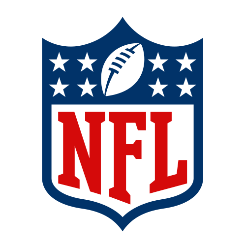
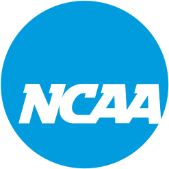

  

    
     
    
     
  

# ESPN API

The ESPN API is a powerful and easy to use way to access athete data.  Below are some of the API routes that we used in this project:

## Base URL

This is the base url of the entire ESPN API.

http://sports.core.api.espn.com/v2

## CDN Base URL

This is the base url of the location for media (images).

https://a.espncdn.com

## 1. GET LEAGUE

Get information about an athletic league.

| Method | Route |
| ------ | ------|
| GET    | {Base URL}/sports/football/leagues/{LEAGUE} |

Examples:

- NFL:
http://sports.core.api.espn.com/v2/sports/football/leagues/nfl
- NCAA:
http://sports.core.api.espn.com/v2/sports/football/leagues/college-football

## 2. GET Teams

This route is used to get a list of teams.

| Method | Route |
| ------ | ------|
| GET    | {League URL}/seasons/{YEAR}/teams |

Examples: 

- NFL:
http://sports.core.api.espn.com/v2/sports/football/leagues/nfl/seasons/2024/teams
- NCAA:
http://sports.core.api.espn.com/v2/sports/football/leagues/college-football/seasons/2024/teams

## 3. GET Team

This route is used to get a specific team.

| Method | Route |
| ------ | ------|
| GET    | {League URL}/seasons/{YEAR}/teams/{ID} |

Examples: 

- NFL:
http://sports.core.api.espn.com/v2/sports/football/leagues/nfl/seasons/2024/teams/1
- NCAA:
http://sports.core.api.espn.com/v2/sports/football/leagues/college-football/seasons/2024/teams/2

## 4. GET Team Athletes

This route is used to get all of the athletes within a team.

| Method | Route |
| ------ | ------|
| GET    | {League URL}/seasons/{YEAR}/teams/{ID}/athletes?limit={LIMIT} |

Examples:
- NFL:
https://sports.core.api.espn.com/v2/sports/football/leagues/nfl/seasons/2024/teams/1/athletes?limit=1000
- NCAA: https://sports.core.api.espn.com/v2/sports/football/leagues/college-football/seasons/2023/teams/2/athletes?limit=1000

## 5. GET Athletes

This route is used to get a list of athletes.

| Method | Route |
| ------ | ------|
| GET    | {League URL}/athletes?page={PAGE} |

Examples:

- NFL:
https://sports.core.api.espn.com/v2/sports/football/leagues/nfl/athletes?page=1
- NCAA:
https://sports.core.api.espn.com/v2/sports/football/leagues/college-football/athletes?page=1

## 6. GET Athlete

This route is used to get a particular athlete.

| Method | Route |
| ------ | ------|
| GET    | {League URL}/athletes/{ID} |

Examples: 

- NFL:
http://sports.core.api.espn.com/v2/sports/football/leagues/nfl/athletes/4678
- NCAA:
https://sports.core.api.espn.com/v2/sports/football/leagues/college-football/athletes/4697420

## 7. GET Athlete Headshot

This route is used to get a particular athlete's headshot.

| Method | Route |
| ------ | ------|
| GET    | {CDN Base URL}/i/headshots/{LEAGUE}/players/full/{ID}.png |

Examples: 

- NFL:
https://a.espncdn.com/i/headshots/nfl/players/full/14320.png
- NCAA:
https://a.espncdn.com/i/headshots/college-football/players/full/4697420.png
