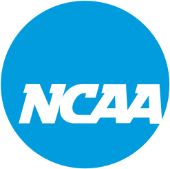
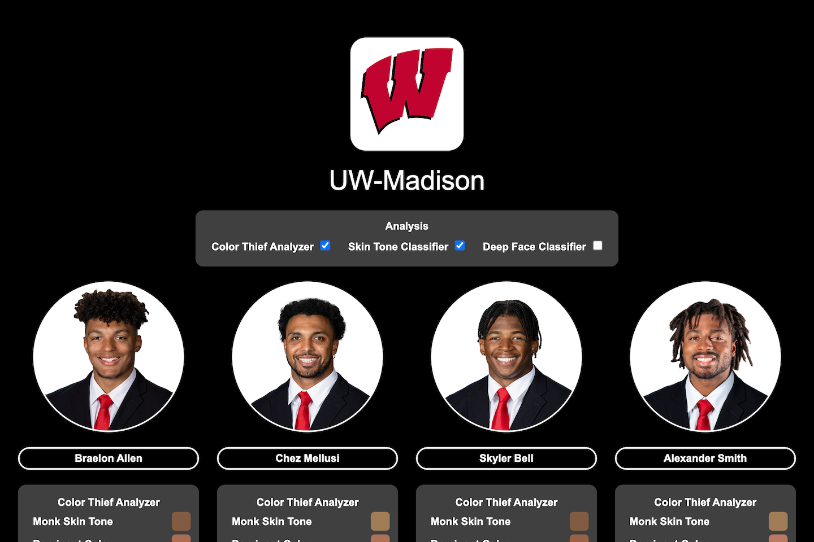
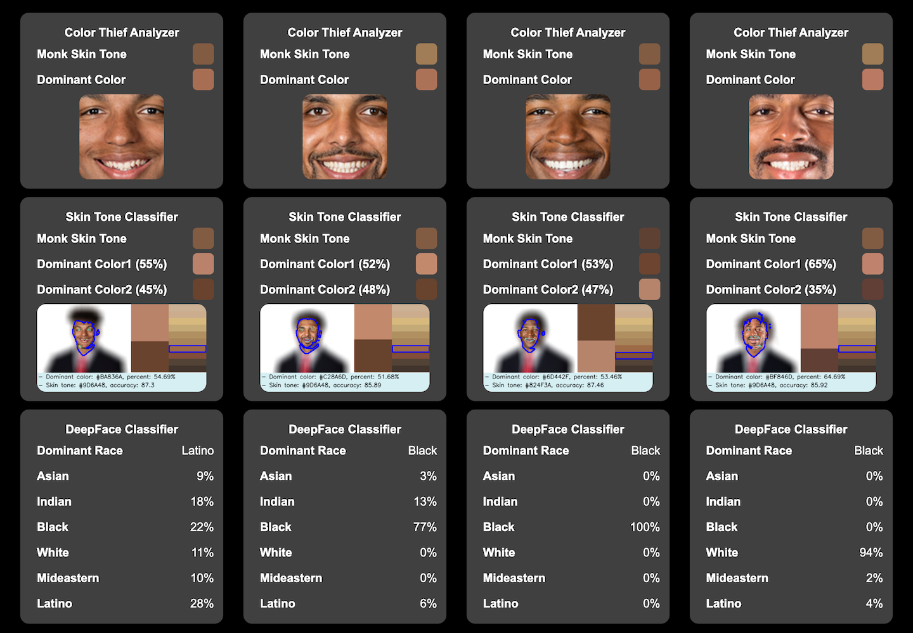
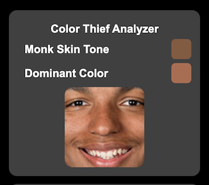
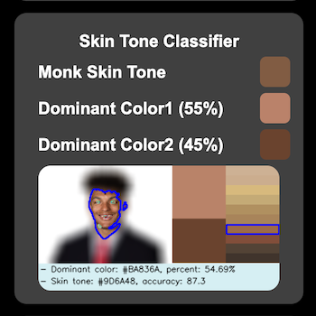
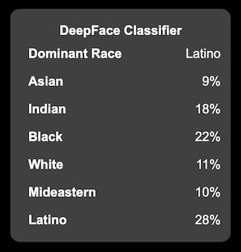

<p align="center">
  <div align="center">
     
  </div>
</p>

# NCAA Athlete Classifier

The NCAA Athlete Classifier is a utility for classifying NCAA atheletes by skin tone using various image  classifiers.


Wisconsin Badgers


Sample Results

This utility uses the following image classifiers:

### 1. Color Thief 
This classifier uses the [Color Thief](https://lokeshdhakar.com/projects/color-thief) utility to find the dominant color form an image and then map that color to the [Monk](https://skintone.google) skin tone scale.



### 2. Skin Tone Classifier
The [Skin Tone Classifier](https://github.com/ChenglongMa/SkinToneClassifier) utility is used to analyze the contents of an image, find the face regions, and perform a skin tone analysis, mapping the final color to the [Monk](https://skintone.google) skin tone scale. 



### 3. Deep Face (Optional)
The [DeepFace](https://github.com/serengil/deepface) utility performs an ethnographic / demographic classification of players based upon the features of images.



## Requirements

### 1. PHP, Python
The utility relies upon the PHP and Python scripting languages.

### 2. SQL Database
The data is stored in a SQL database for easy querying and analysis.  You will need MySQL, MariaDB, or an equivalent.

### 3. ColorThief
The [ColorThief](https://github.com/fengsp/color-thief-py) utility is used to perform an image based ethnographic / demographic classification of players.

### 4. Skin Tone Classifier
The [Skin Tone Classifier](https://pypi.org/project/skin-tone-classifier/) utility is used to perform an image based ethnographic / demographic classification of players.

### 3. DeepFace (Optional)
The [DeepFace](https://pypi.org/project/deepface/) utility is used to perform an image based ethnographic / demographic classification of players.

## Installation

### 1. Database

Create a database called "athletics".  Then, run the following scripts to create the required database tables:

1. [database/players_data.sql](database/players_data.sql) This creates the database table to hold data from the [players_data_final.csv](data/Coding/players_data_final.csv) spreadsheet.

2. [database/4_universities.sql](database/4_universities.sql) This creates the database table to hold data from the [4 Universities Coding.csv](data/Coding/4%20Universities%20Coding.csv) spreadsheet.

### 2. ColorThief
Please install the ColorThief utility by running:

```
pip install colorthief
```

### 2. Skin Tone Classifier
Please install the Skin Tone Classifier utility by running:

```
pip install skin-tone-classifier --upgrade
```

### 2. DeepFace (Optional)
Please install the DeepFace utility by running:

```
pip install deepface
```

## Configuration

### 1. Database
To configure the scripts to write to your database, locate the file "utilities/database". Please make sure that the following database settings are correct for your database instance:

```
define('DATABASE_HOST', '127.0.0.1');
define('DATABASE_USERNAME', 'root');
define('DATABASE_PASSWORD', 'root');
define('DATABASE_NAME', 'athletics');
```

## Running
Scripts are provided for fetching and processing both athletes and teams: 

### 1. Initialize the database

First, we'll add the source data to the database. To do this, run:

```
cd src/database-initializer
sh store_player_data.sh
sh store-4-universities.sh
```

### 2. Add Your Data

Next, add your athlete images to the data directory.  We recommend creating an 'NCAA' folder inside of data directory.  Inside of this folder there should be one folder for each team.  

```
data/
    NCAA/
        Air Force/
        Akron/
        ...
```

Inside of each team folder should be the team images.  Team images are named using the convention: NUMBER.LASTNAME.POSITION.TEAM.jpg.  

For example: 
```
83.Carter-Hill.TE.Air Force.jpg
```

### 3. Run the Color Thief Analyzer

Next, we'll run the Color Thief Analyzer on the source images.  To do this, run:

```
cd src/color-analyzer
sh analyze-ncaa-teams.sh
sh analyze-selected-ncaa-teams.sh
```

When this is complete, it will have created a set of folders inside of the 'data/NCAA' team folders called "Colors", and "Cropped".

### 4. Run the Skin Tone Classifier Analyzer

Next, we'll run the Color Thief Analyzer on the source images.  To do this, run:

```
cd src/skin-tone-classifier
sh skin-tone-ncaa-teams.sh
sh skin-tone-selected-ncaa-teams.sh
```

When this is complete, it will have created a set of folders inside of the 'data/NCAA' team folders called "Reports", "RGB", and "Skin Tones".

### 5. Run the DeepFace Classifier Analyzer (Optional)

Next, we'll run the DeepFace Analyzer on the source images.  To do this, run:

```
cd src/demographic-classifier
sh classify-ncaa-teams.sh
sh classify-selected-ncaa-teams.sh
```

When this is complete, it will have created a set of folders inside of the 'data/NCAA' team folders called "Demography".

### 6. Add Analyzer Data To Database
Next, we'll add the analyzer data back into the original source data.

```
cd src/data-manager
sh store-ncaa-teams.sh
sh store-selected-ncaa-teams.sh

```

<!-- LICENSE -->
## Results

The results of the analysis can be found in:

1) [players_data.csv](results/players_data.csv)
This is the original NCAA database with the classifier information appended.

1) [players_data_cleaned.csv](results/players_data_cleaned.csv)
This is the original NCAA database with duplicates removed and the classifier information appended.

2)  [4 Universities Coding.csv](results/4%20Universities%20Coding.csv)
This is a small subset of the NCAA database including 4 teams (Wisconsin Badgers, Maryland Terrapins, Ohio State Buckeyes, and Michigan Wolverines) with manual skin tone classifications.

<!-- LICENSE -->
## License

Distributed under the MIT License which allows urestricted use of the software. See [LICENSE.txt](LICENSE.txt) for more information.

<!-- CONTACT -->
## Acknowledgements
This software was made possible by the following organizations:

1. [University of Wisconsin](http://wisc.edu) [School of Business](http://business.wisc.edu)

1. [University of Wisconsin](http://wisc.edu) [Data Science Institute](http://datascience.wisc.edu)

2. [ESPN](http://espn.com)

Thank you to ESPN for providing access to their data through their API.  This software was created without involvement from or any association with the ESPN organization.

<!-- CONTACT -->
## Contact

Abe Megahed - (mailto:amegahed@wisc.edu)
